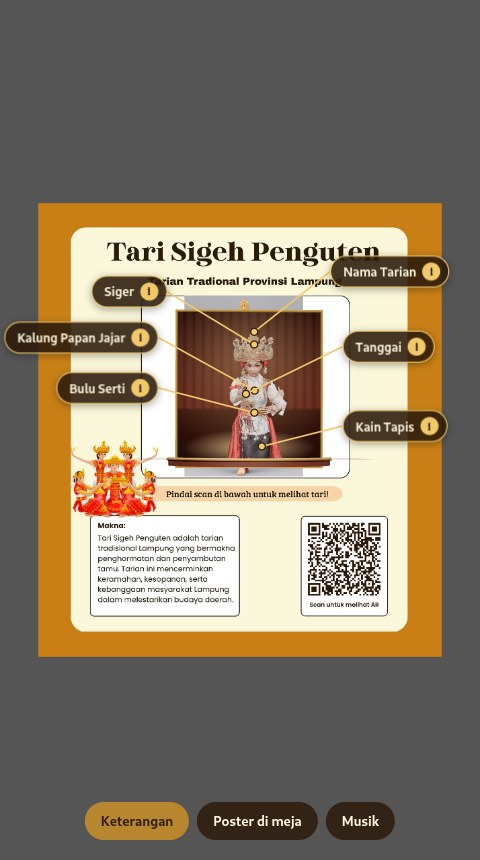
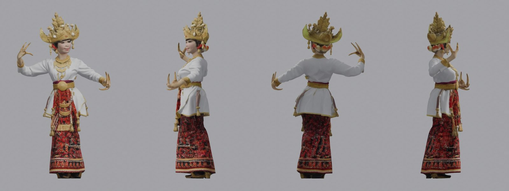

# Tari Sigeh Penguten AR

Web AR untuk mengenalkan **Tari Sigeh Penguten**, tarian penyambutan tamu dari Provinsi Lampung.
Pindai QR di poster, arahkan kamera HP ke poster, lalu penari 3D berkostum adat Lampung muncul di atas
panggung dan menari mengikuti gerakan dari video tari asli, lengkap dengan keterangan bagian kostumnya.

**Coba langsung:** <https://rhmatzeka.github.io/SigehPenguten-AR/>
(buka di HP, lalu arahkan kamera ke [poster](poster/poster-tari-sigeh-qr.png))

<p align="center">
  
</p>

## Fitur

- **Tanpa install aplikasi**: cukup browser HP (Chrome di Android, Safari di iPhone).
- **Penari 3D menari** di atas panggung setengah lingkaran bermotif tapis, gerakannya diambil dari video tari asli.
- **Keterangan kostum**: label Nama Tarian, Siger, Kalung Papan Jajar, Tanggai, Bulu Serti, dan Kain Tapis.
  Garis penunjuknya ikut bergerak bersama penari, dan setiap label bisa diketuk untuk membaca penjelasannya.
- **Zoom & putar**: cubit dua jari untuk zoom, geser satu jari untuk memutar penari, ketuk dua kali untuk
  kembali semula (di laptop: scroll dan drag mouse).
- **Dua mode**: poster di dinding/layar (penari berdiri tegak di depan poster) atau poster di meja
  (penari berdiri keluar dari kertas).
- **Ringan**: model 3D sekitar 2 MB (kompresi Draco), jadi cepat dimuat di HP.

## Cara pakai

1. Cetak [poster](poster/poster-tari-sigeh-qr.pdf), atau tampilkan di layar laptop.
2. Pindai QR di pojok kanan bawah poster dengan kamera HP.
3. Tekan **Mulai AR**, izinkan akses kamera, lalu arahkan kamera ke seluruh poster.
4. Cubit untuk zoom, geser untuk memutar penari, ketuk dua kali untuk kembali semula.
5. Ketuk label untuk membaca keterangan. Tombol **Keterangan** menampilkan/menyembunyikan label,
   tombol **Poster di meja** mengganti mode saat poster diletakkan rata.

## Model 3D

<p align="center">
  
</p>

## Teknologi

| Bagian | Alat |
|---|---|
| Pelacakan poster (image tracking) | [MindAR](https://github.com/hiukim/mind-ar-js) 1.2.5 |
| Tampilan 3D di browser | [Three.js](https://threejs.org) r160 |
| Foto → model 3D | [TRELLIS.2](https://huggingface.co/spaces/microsoft/TRELLIS.2) (Microsoft) |
| Video tari → gerakan (motion capture) | [MediaPipe Pose](https://ai.google.dev/edge/mediapipe/solutions/vision/pose_landmarker) |
| Rigging, tekstur wajah, animasi | [Blender](https://www.blender.org) 4.2 (skrip Python, tanpa UI) |
| Hosting | GitHub Pages |

## Cara model dan animasinya dibuat

Semua langkah dijalankan dengan skrip di folder [`tools/`](tools/):

1. **Foto → model 3D**: `gen_trellis2.py` mengirim foto penari ke TRELLIS.2 dan mengunduh model GLB bertekstur.
2. **Tekstur lebih tajam**: `foto_tajam.py`, `render_depan.py`, dan `sejajar_foto.py` menyejajarkan foto asli
   resolusi penuh ke wajah model memakai 468 titik wajah MediaPipe, lalu `proyeksi_wajah.py` menempelkan foto
   itu ke permukaan depan model.
3. **Video → gerakan**: `ekstrak_pose.py` mendeteksi 33 titik tubuh di setiap frame video, lalu
   `rapikan_pose.py` mengisi frame kosong, menghaluskan getaran, menempelkan kaki ke lantai, dan memakai pose
   duduk bersimpuh saat penari duduk (kaki di video tertutup kain tapis).
4. **Rigging + animasi**: `rig_animasi.py` memasang 19 tulang otomatis dari titik tubuh di foto, membagi bobot
   kulit (rok dibuat ikut pinggul supaya tidak terbelah), mengganti tangan dengan tangan buatan berkuku
   tanggai emas (`tangan.py`), memasang gerakan dari video, lalu mengekspor GLB terkompresi.
5. **Target pindai**: poster ber-QR dibuat dengan `tempel_qr.py`, lalu dikompilasi menjadi `assets/poster.mind`
   dengan compiler MindAR.

## Struktur folder

```
index.html            halaman AR (MindAR + Three.js, label keterangan, panggung 3D)
assets/penari.glb     model penari beranimasi (Draco)
assets/poster.mind    target pindai MindAR dari poster
poster/               poster siap cetak (PNG & PDF) dengan QR
qr/                   file QR (PNG & SVG)
tools/                skrip pembuatan model, tekstur, mocap, dan rigging
docs/                 rancangan dan gambar README
```

## Menjalankan di komputer sendiri

Kamera browser butuh HTTPS atau `localhost`:

```bash
python3 -m http.server 8000
# buka http://localhost:8000 lalu arahkan webcam ke poster
```

## Catatan

- Teks keterangan kostum ditulis dari pengetahuan umum tentang pakaian adat Lampung.
  Untuk keperluan tugas, sebaiknya dicocokkan lagi dengan materi dari guru atau sumber resmi.
- Link lama `rhmatzeka.github.io/tari-sigeh-penguten` tetap berfungsi dan otomatis mengalihkan ke halaman ini,
  jadi QR pada poster yang sudah dicetak tidak perlu diganti.
